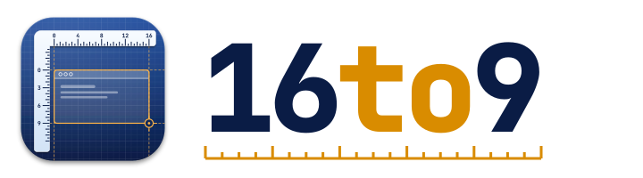
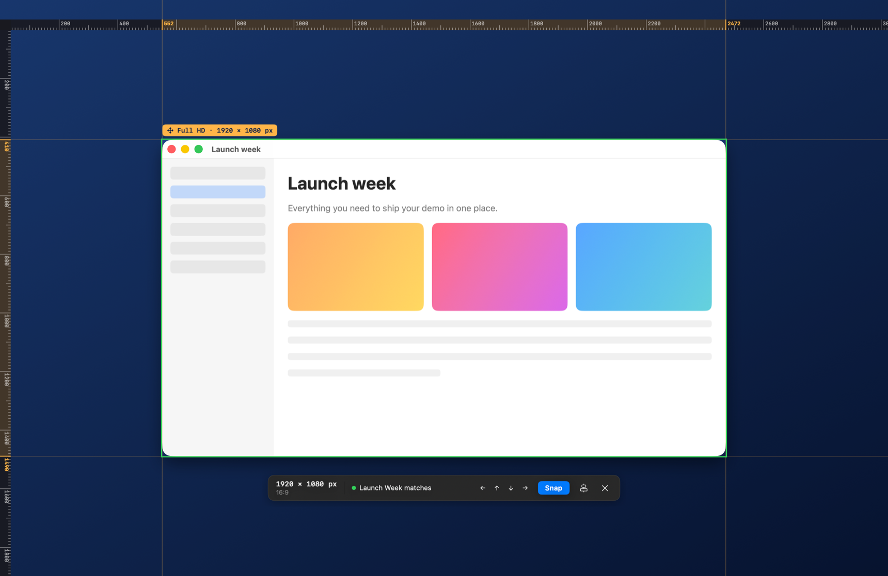
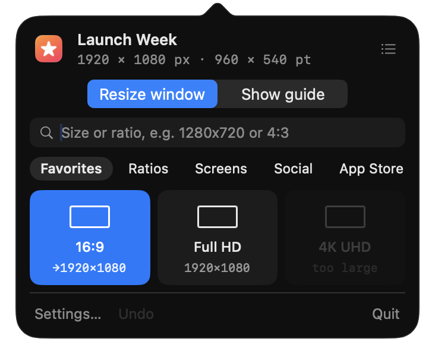

  <picture>
    <source media="(prefers-color-scheme: dark)" srcset="design/logos/final/wordmark.svg">
    
  </picture>

Resize any Mac window to an exact size or ratio. For screenshots, screen recordings and demos that must have a fixed size.

  <a href="https://github.com/zirkelc/16to9/releases/latest"><b>Download for macOS</b></a> · macOS 14 or later · Free and open source

## Features

- **Exact sizes.** Select a preset or type `1920x1080`, and the front window gets this size.
- **Ratios with the smallest change.** Select 16:9, 4:3, 9:16 or type `1.91:1`. 16to9 keeps the width or the height, and changes the window as little as possible.
- **Guide with rulers.** A frame with rulers shows the target size on the screen, so that you can place and size a window by hand. Each edge turns green when the window matches. Snap moves the window into the frame. Screenshots and screen recordings do not show the guide.
- **Presets.** Built-in sizes for social posts (X, LinkedIn, Instagram, YouTube, Open Graph), screens (Full HD, 4K, MacBook) and Mac App Store screenshots. Add your own presets and put the ones you use most in Favorites.
- **Pixels, not guesses.** Sizes are in screenshot pixels, so a window screenshot has exactly the size you select, also on a Retina screen. You can change to points in Settings.
- **Shortcuts.** Show the guide from any app with ⌃⌥G, give each preset its own shortcut, and undo the last resize.
- **Preview.** While you point at a size in the menu, a frame on the screen shows the new size before you click.

## Install

1. Download the DMG from [Releases](https://github.com/zirkelc/16to9/releases/latest).
2. Open it and drag 16to9 into Applications.
3. Start 16to9. A short tour shows how to give it the Accessibility permission.

The app is signed with a Developer ID, notarized by Apple, and updates itself with [Sparkle](https://sparkle-project.org).

## Use

Click the 16to9 icon in the menu bar. Select **Resize window** or **Show guide**, then select a preset or type a size or ratio:

| You type | The window gets |
| --- | --- |
| `1280x720` or `1280 720` | 1280 × 720 |
| `16:9` | The ratio 16:9, with the smallest change |
| `1.91:1` | The ratio 1.91:1, with the smallest change |

While the guide shows:

| Key | Action |
| --- | --- |
| ⌃⌥G | Show or hide the guide (from any app) |
| ← → ↑ ↓ | Move the frame by 1 px (2 px on a Retina screen, because windows move by whole points) |
| ⇧ and an arrow key | Move the frame by 10 px |
| Esc | Hide the guide |

You can change all shortcuts in Settings › Shortcuts.

## Why the Accessibility permission?

macOS lets an app move and resize the windows of other apps only with the Accessibility permission. 16to9 uses it only to read and set the position and size of the front window. It does not read the contents of windows. The guide works without the permission.

16to9 collects no data and has no analytics. The only network access is the check for updates. See the [privacy policy](PRIVACY.md).

## FAQ

**Why is 16to9 not in the Mac App Store?** Apps in the Mac App Store must use the App Sandbox, and the sandbox blocks the Accessibility API for other apps.

**Why does a window not get the exact size?** Some apps limit their window size, for example to a minimum size or to full lines of text in a terminal. 16to9 then shows a message with the size that the app accepted.

**Pixels or points?** macOS measures windows in points. On a Retina screen, 1 point is 2 pixels. A window screenshot (⇧⌘4, then Space) has the size in pixels, so 16to9 uses pixels by default. Hold ⌥ when you click to leave out the shadow.

## Build from source

See [CONTRIBUTING.md](CONTRIBUTING.md).

## License

[MIT](LICENSE). The app bundles the font JetBrains Mono, which has the [SIL Open Font License 1.1](App/Resources/Fonts/JetBrainsMono-OFL.txt).
