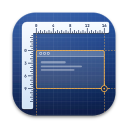

# 16to9

A macOS menu bar app that resizes windows to exact sizes (for example 1920 × 1080) or to ratios (for example 16:9) with the smallest change. It can also show a guide frame with rulers, so that you can size a window by hand.

- Plan: [docs/PLAN.md](docs/PLAN.md)
- Mockup: [design/mockup.html](design/mockup.html)

## Install

Download the DMG of the newest version from [Releases](https://github.com/zirkelc/16to9/releases) and drag 16to9 into Applications. The app is signed with a Developer ID and notarized by Apple. It updates itself with [Sparkle](https://sparkle-project.org).

To resize windows, the app needs the Accessibility permission. The welcome tour shows how to give it. The guide frame works without the permission. The app collects no data: see the [privacy policy](PRIVACY.md).

## Requirements

- macOS 14 or later
- Xcode 26 or later
- [XcodeGen](https://github.com/yonaskolb/XcodeGen) (`brew install xcodegen`)

## Build

The Xcode project is generated from `project.yml` and is not in Git.

```sh
xcodegen generate
xcodebuild -project 16to9.xcodeproj -scheme 16to9 -configuration Debug -derivedDataPath build/DerivedData build
open "build/DerivedData/Build/Products/Debug/16to9 (dev).app"
```

The Debug build is a separate app, "16to9 (dev)", with the bundle ID `dev.zirkelc.16to9.dev`. It has its own settings and its own Accessibility permission, so it can be installed and run next to the release build. Its app icon has a red "DEV" label (a red dot at small sizes), and its menu bar icon has a dot at the top right. It never checks for updates. Both apps have the same default shortcuts. When both run, only one of them gets a shortcut, so change the shortcuts of one app in Settings.

Start the app with `open` or from Finder. Then the app uses its own Accessibility permission. When a terminal starts the binary, macOS uses the permission of the terminal.

The debug build is signed with the development certificate of the team, so the Accessibility permission stays after a rebuild. If you are not in the team, set your own team with `DEVELOPMENT_TEAM=<team ID>` at the end of the `xcodebuild` command. A build without signing (`CODE_SIGNING_ALLOWED=NO`) also runs, but macOS then asks for the Accessibility permission again after each build.

The app does not use the App Sandbox, because the sandbox blocks the Accessibility API for other apps. For this reason it is distributed outside the Mac App Store.

## Test

The logic for sizes, ratios, rulers and presets is in the Swift package `Packages/ResizerCore` and has no AppKit dependency.

```sh
cd Packages/ResizerCore
swift test
```

## Debug screens

Debug builds read `APP_DEBUG_SHOW` at launch and open one part of the app. This is for screenshots and manual checks:

| Value | Opens |
| --- | --- |
| `popover` | The menu bar popover |
| `guide` | The guide with 1920 × 1080 |
| `guide-snap` | The guide, then snaps the front window to it |
| `resize:16:9` | Resizes the front window to the value after `resize:` |
| `preview:16:9` | Shows the size preview of the value after `preview:` for the front window, as if the pointer is on it in the menu |
| `onboarding` | The onboarding tour from its first step |
| `onboarding-<step>` | One step of the tour: `welcome`, `howItWorks`, `permission`, `tryIt`, `tryGuide` or `done` |
| `onboarding-resized` | The Done step after a resize of a Finder window |
| `permission-card` | System Settings with the card to drag the app into the Accessibility list (also when the permission is on) |
| `settings-cycle` | Switches through all settings tabs and logs the window frame and the time of each switch |
| `general`, `presets`, `shortcuts`, `about`, `settings-guide` | A settings pane (the prefix `settings-` works for all panes) |

`APP_DEBUG_SECTION=social` selects a group in the Presets pane. `APP_DEBUG_EDITOR=1` opens the sheet for a new preset (`ratio` opens it for a ratio). `APP_DEBUG_RECORDING=1` makes the first shortcut field that appears start to record, so that its popover shows. `APP_DEBUG_DENIED=1` shows all screens as if the Accessibility permission is off. Launch arguments override settings, for example `-popoverLayout grid` or `-hideGuideInScreenshots NO`.

## Logs

The app writes to the unified system log. The subsystem is the bundle ID (`dev.zirkelc.16to9` or `dev.zirkelc.16to9.dev`), and the categories are `app`, `resize`, `guide`, `permission` and `shortcuts`. Resizes, snaps, the guide, permission changes and Accessibility errors are logged as notice or error, so they stay on disk. Shortcuts and tour steps are logged as info, which is only in memory. Window titles are never logged.

zsh has its own `log` command, so the commands use the full path `/usr/bin/log`.

```sh
# Live, with all levels (use the bundle ID of the build you test):
/usr/bin/log stream --level debug --predicate 'subsystem == "dev.zirkelc.16to9.dev"'
# The last hour from disk:
/usr/bin/log show --last 1h --info --predicate 'subsystem == "dev.zirkelc.16to9"'
```

Console.app shows the same messages: search for the subsystem, and turn on Action > Include Info Messages.

## Translations

The app is in English and German. The texts are in two string catalogs in `App/Resources`: `Localizable.xcstrings` for the UI and `Presets.xcstrings` for the names of the built-in presets. Xcode adds new texts from the code to `Localizable.xcstrings` when it builds. To check for texts without a translation:

```sh
xcodebuild -exportLocalizations -project 16to9.xcodeproj -localizationPath build/loc -exportLanguage de
```

To see the app in German, start it with `-AppleLanguages "(de)"`.

## Release

`scripts/release.sh <version> <build>` archives the app, exports it with the Developer ID certificate, notarizes the app and the DMG, publishes the DMG as a GitHub release and writes the Sparkle feed to `site/appcast.xml`. When you push the feed, the Pages workflow publishes it at `https://zirkelc.github.io/16to9/appcast.xml`, and the installed apps find the update. The one-time setup is in the comment at the top of the script and in the release checklist in [docs/PLAN.md](docs/PLAN.md).

The CI workflow runs the tests of `ResizerCore` and makes a Release build without signing for each push and pull request.

## App icon

The app icons (`AppIcon` and `AppIcon-Dev` for the Debug build) and the menu bar glyph come from the SVG files in `design/logos/final/`. The full icon is for 128 px and larger, and the simple icon is for 64 px and smaller. After a change to the SVG files, run (needs `rsvg-convert` from librsvg):

```sh
scripts/make-icon.sh
```

macOS keeps old app icons in a cache. If a Debug build still shows the old icon, register the app again: `/System/Library/Frameworks/CoreServices.framework/Frameworks/LaunchServices.framework/Support/lsregister -f "build/DerivedData/Build/Products/Debug/16to9 (dev).app"`.

## License

[MIT](LICENSE). The app bundles the font JetBrains Mono, which has the [SIL Open Font License 1.1](App/Resources/Fonts/JetBrainsMono-OFL.txt).
